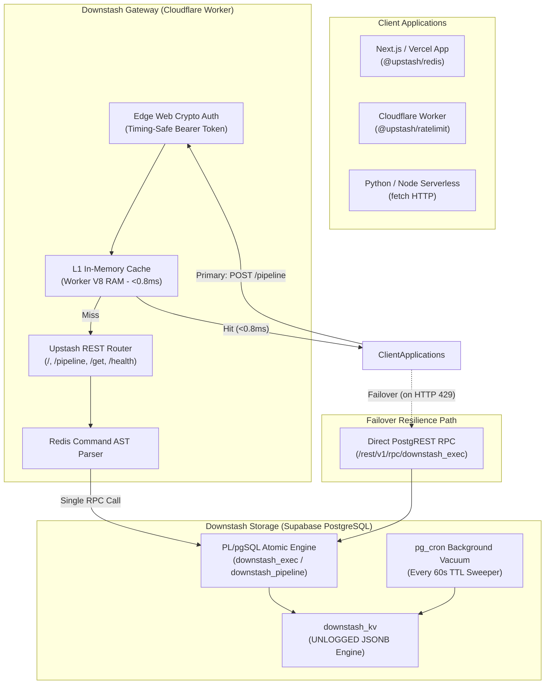
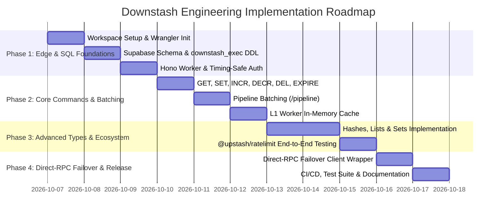

# Product Requirements Document (PRD)

# Project Name: Downstash

**The Zero-Cost, Self-Hosted Serverless Redis & Ratelimit Engine**

---

| Attribute            | Specification                                            |
| :------------------- | :------------------------------------------------------- |
| **Document Version** | 1.0.0                                                    |
| **Status**           | Approved / Ready for Implementation                      |
| **Author**           | Downstash Core Architecture Team                         |
| **Target Platforms** | Cloudflare Workers (Edge), Supabase PostgreSQL (Storage) |
| **License**          | MIT (Personal & Commercial Open-Source)                  |
| **Target Budget**    | **$0.00 / month forever**                                |

---

## 1. Executive Summary & Problem Statement

### 1.1 Background

Serverless platforms such as Vercel, Cloudflare Workers, Next.js, and AWS Lambda require stateless, connection-pool-friendly data stores. Traditional Redis relies on persistent TCP socket connections (port 6379), which quickly exhaust connection limits and suffer from cold-start overheads in serverless environments.

**Upstash** pioneered the serverless Redis model by wrapping Redis commands inside an HTTP REST API. However, Upstash's free tier imposes severe constraints:

- **10,000 commands/day hard limit:** Exceeding this quota triggers immediate HTTP 429 rejections, breaking rate limiters and auth sessions.
- **256 MB maximum storage:** Inadequate for larger caching layers or long-lived data.
- **Pay-As-You-Go Billing Risk:** Connecting a credit card exposes developers to unexpected bills from DDoS attacks or unintentional infinite loops ($0.20–$0.40 per 100k commands).

### 1.2 The Solution: Downstash

**Downstash** is a self-hosted, 100% serverless, zero-maintenance key-value and rate-limiting engine. It implements the exact HTTP REST wire protocol of Upstash, allowing applications to use official `@upstash/redis` and `@upstash/ratelimit` packages as a **drop-in replacement** with zero code changes.

By combining **Cloudflare Workers** (Free Edge Gateway) with **Supabase PostgreSQL** (Free ACID Storage Engine) and an automated **Direct-RPC Failover Layer**, Downstash provides:

- **10x to 40x higher free daily requests:** 100,000 req/day on Cloudflare + ~350,000+ req/day via Direct-RPC.
- **2x more free storage:** 500 MB Postgres storage.
- **Absolute cost immunity:** $0.00 operating expenses with zero risk of surprise bills.
- **Sub-millisecond reads:** L1 in-memory edge cache inside Cloudflare Worker V8 isolates.

---

## 2. Goals & Non-Goals

### 2.1 Goals

1. **100% Wire Compatibility:** Seamless interoperability with `@upstash/redis` and `@upstash/ratelimit` by matching `POST /`, `POST /pipeline`, and `GET /get/:key` REST specifications.
2. **True $0.00 Infrastructure:** Run completely within the permanent free tiers of Cloudflare Workers and Supabase.
3. **Atomic Execution:** Prevent race conditions in counters and rate limiters via PostgreSQL row-level locks and PL/pgSQL transactions.
4. **Resilient Failover:** Support automated client-side fallback to Supabase Direct-RPC if the Cloudflare daily invocation ceiling is reached.
5. **Zero Maintenance & No Cold Sleeps:** Automate TTL key sweeps via `pg_cron`, ensuring Supabase never triggers its 7-day inactivity pause.

### 2.2 Non-Goals

1. **Raw TCP RESP Wire Protocol:** Downstash does not expose TCP port 6379 for legacy clients like `redis-cli` or `ioredis`. It is designed strictly for HTTP REST serverless runtimes.
2. **Redis Streams & Pub/Sub:** Niche streaming commands (`XADD`, `XREAD`, `SUBSCRIBE`) are out of scope. (Real-time messaging can leverage native Supabase WebSockets).
3. **Multi-Tenant SaaS Billing:** Phase 1 is optimized for single-tenant / personal developer use across unlimited private projects.

---

## 3. System Architecture & Topology



### 3.1 Component Specifications

#### A. Edge Gateway (Cloudflare Worker)

- **Framework:** Hono (TypeScript).
- **Role:** Authenticates incoming requests, serves hot reads from V8 isolate RAM, parses Redis commands, and bundles pipelines into atomic PostgreSQL RPC calls.
- **Hosting:** Cloudflare Workers Free Plan (100,000 invocations / day, 10ms CPU limit, global anycast routing across 300+ cities).

#### B. Storage Engine (Supabase PostgreSQL)

- **Table Architecture:** `UNLOGGED` relational table with JSONB document storage.
- **Why `UNLOGGED`?** Bypasses Write-Ahead Logging (WAL) on disk, granting in-memory RAM write performance (~10–15ms) ideal for cache layers.
- **Hosting:** Supabase Free Tier (500 MB database, shared compute, 2 GB egress bandwidth).

#### C. Direct-RPC Fallback Layer

- **Role:** In the event that Cloudflare Worker reaches its 100k daily quota (HTTP 429), client SDK seamlessly reroutes requests directly to Supabase's native HTTPS PostgREST RPC endpoint (`/rest/v1/rpc/downstash_exec`).
- **Capacity:** Supabase has no daily request limit, enabling **~350,000+ additional daily operations** bounded only by bandwidth.

---

## 4. API & Protocol Specification

### 4.1 Authentication

Every request must include an HTTP Authorization header containing a valid Bearer token:

```http
Authorization: Bearer <DOWNSTASH_TOKEN>
```

Authentication is verified at the edge using `crypto.subtle.timingSafeEqual` to eliminate timing attack vectors. Requests with invalid or missing tokens return `HTTP 401 Unauthorized` immediately without querying the database.

---

### 4.2 Core Endpoints

#### Endpoint 1: Single Command (`POST /`)

Executes an individual Redis command represented as a JSON array.

- **Request:**

  ```http
  POST / HTTP/1.1
  Host: downstash.yourdomain.workers.dev
  Authorization: Bearer my-secret-token
  Content-Type: application/json

  ["SET", "user:session:42", "{\"user\":\"alex\"}", "EX", 3600]
  ```

- **Success Response (HTTP 200):**

  ```json
  {
    "result": "OK"
  }
  ```

- **Error Response (HTTP 400):**
  ```json
  {
    "error": "ERR wrong number of arguments for 'set' command"
  }
  ```

---

#### Endpoint 2: Batch Pipeline (`POST /pipeline`)

Executes multiple Redis commands sequentially within a single atomic database transaction.

- **Request:**

  ```http
  POST /pipeline HTTP/1.1
  Host: downstash.yourdomain.workers.dev
  Authorization: Bearer my-secret-token
  Content-Type: application/json

  [
    ["INCR", "ratelimit:ip:10.0.0.1"],
    ["EXPIRE", "ratelimit:ip:10.0.0.1", 60],
    ["GET", "ratelimit:ip:10.0.0.1"]
  ]
  ```

- **Success Response (HTTP 200):**
  ```json
  [{ "result": 1 }, { "result": 1 }, { "result": "1" }]
  ```

---

#### Endpoint 3: Path-Based GET Commands

Convenience endpoints for browser testing, webhooks, and curl invocations:

- `GET /get/:key` $\rightarrow$ `{ "result": "val" }`
- `GET /set/:key/:val` $\rightarrow$ `{ "result": "OK" }`
- `GET /del/:key` $\rightarrow$ `{ "result": 1 }`
- `GET /incr/:key` $\rightarrow$ `{ "result": 2 }`
- `GET /health` $\rightarrow$ `{ "status": "healthy", "service": "downstash", "version": "1.0.0" }`

---

## 5. Redis Command Coverage Matrix

| Category    | Command     | Syntax Example                     | Postgres Implementation                                                                      |
| :---------- | :---------- | :--------------------------------- | :------------------------------------------------------------------------------------------- | --- | --- |
| **Strings** | `GET`       | `["GET", "k"]`                     | `SELECT val FROM downstash_kv WHERE key = $1 AND (expires_at IS NULL OR expires_at > now())` |
|             | `SET`       | `["SET", "k", "v", "EX", 60]`      | `INSERT ... ON CONFLICT (key) DO UPDATE` with calculated `expires_at`                        |
|             | `SETNX`     | `["SETNX", "k", "v"]`              | `INSERT ... ON CONFLICT (key) DO NOTHING`                                                    |
|             | `SETEX`     | `["SETEX", "k", 60, "v"]`          | `INSERT ... ON CONFLICT` with explicit TTL seconds                                           |
|             | `MGET`      | `["MGET", "k1", "k2"]`             | `SELECT key, val FROM downstash_kv WHERE key = ANY($1)`                                      |
|             | `MSET`      | `["MSET", "k1", "v1", "k2", "v2"]` | Batch upsert statement                                                                       |
|             | `INCR`      | `["INCR", "k"]`                    | Atomic increment returning new integer value                                                 |
|             | `INCRBY`    | `["INCRBY", "k", 5]`               | Atomic increment by integer delta                                                            |
|             | `DECR`      | `["DECR", "k"]`                    | Atomic decrement returning new integer value                                                 |
|             | `DECRBY`    | `["DECRBY", "k", 5]`               | Atomic decrement by integer delta                                                            |
|             | `DEL`       | `["DEL", "k1", "k2"]`              | `DELETE FROM downstash_kv WHERE key = ANY($1)`                                               |
|             | `EXISTS`    | `["EXISTS", "k"]`                  | Returns `1` if key is present and not expired, else `0`                                      |
| **Expiry**  | `EXPIRE`    | `["EXPIRE", "k", 300]`             | `UPDATE downstash_kv SET expires_at = now() + (300 * interval '1 second')`                   |
|             | `TTL`       | `["TTL", "k"]`                     | Returns remaining seconds, `-1` if no TTL, `-2` if missing/expired                           |
|             | `PERSIST`   | `["PERSIST", "k"]`                 | `UPDATE downstash_kv SET expires_at = NULL WHERE key = $1`                                   |
| **Hashes**  | `HSET`      | `["HSET", "h", "f1", "v1"]`        | Upsert JSONB object with `jsonb_set` or concatenation `                                      |     | `   |
|             | `HGET`      | `["HGET", "h", "f1"]`              | Returns `val->>'f1'`                                                                         |
|             | `HGETALL`   | `["HGETALL", "h"]`                 | Returns flattened key-value array `["f1", "v1", "f2", "v2"]`                                 |
|             | `HDEL`      | `["HDEL", "h", "f1"]`              | JSONB key subtraction `val - 'f1'`                                                           |
|             | `HLEN`      | `["HLEN", "h"]`                    | Count of keys in JSONB object                                                                |
| **Lists**   | `LPUSH`     | `["LPUSH", "l", "item"]`           | Prepend to JSONB array                                                                       |
|             | `RPUSH`     | `["RPUSH", "l", "item"]`           | Append to JSONB array                                                                        |
|             | `LPOP`      | `["LPOP", "l"]`                    | Remove and return element at index 0                                                         |
|             | `LRANGE`    | `["LRANGE", "l", 0, -1]`           | Array slice returning requested element window                                               |
|             | `LLEN`      | `["LLEN", "l"]`                    | `jsonb_array_length(val)`                                                                    |
| **Sets**    | `SADD`      | `["SADD", "s", "m1", "m2"]`        | Append unique elements to JSONB set array                                                    |
|             | `SMEMBERS`  | `["SMEMBERS", "s"]`                | Return all unique set items                                                                  |
|             | `SISMEMBER` | `["SISMEMBER", "s", "m1"]`         | Return `1` if item in array, else `0`                                                        |
|             | `SREM`      | `["SREM", "s", "m1"]`              | Remove element from JSONB array                                                              |
| **Server**  | `KEYS`      | `["KEYS", "prefix:*"]`             | Pattern matching using SQL `LIKE 'prefix:%'`                                                 |
|             | `DBSIZE`    | `["DBSIZE"]`                       | Count of unexpired keys in table                                                             |
|             | `FLUSHDB`   | `["FLUSHDB"]`                      | `TRUNCATE TABLE downstash_kv`                                                                |
|             | `PING`      | `["PING"]`                         | Returns `"PONG"`                                                                             |

---

## 6. Database Schema & Stored Procedure Specifications

### 6.1 Database Migration DDL (`downstash_schema.sql`)

```sql
-- 1. Create Downstash Key-Value Storage Table
create unlogged table if not exists public.downstash_kv (
    key text primary key,
    data_type text not null default 'string', -- 'string', 'hash', 'list', 'set', 'zset'
    val jsonb not null,
    expires_at timestamptz default null,
    created_at timestamptz default now(),
    updated_at timestamptz default now()
);

-- 2. Partial index for active TTL vacuum sweeps
create index if not exists idx_downstash_expires_at
on public.downstash_kv (expires_at)
where expires_at is not null;

-- 3. Pattern search index for KEYS / SCAN operations
create index if not exists idx_downstash_key_pattern
on public.downstash_kv (key text_pattern_ops);

-- 4. Enable Row Level Security (RLS) - protected by service_role
alter table public.downstash_kv enable row level security;
```

---

### 6.2 Atomic Execution Engine (`downstash_exec.sql`)

```sql
create or replace function public.downstash_exec(p_cmd text, p_args jsonb default '[]'::jsonb)
returns jsonb
language plpgsql
security definer
as $$
declare
    v_cmd text := upper(trim(p_cmd));
    v_key text;
    v_val jsonb;
    v_res jsonb;
    v_ttl bigint;
    v_now timestamptz := now();
begin
    v_key := p_args->>0;

    case v_cmd
        -- PING
        when 'PING' then
            return '"PONG"'::jsonb;

        -- GET
        when 'GET' then
            select val into v_res
            from public.downstash_kv
            where key = v_key and (expires_at is null or expires_at > v_now);
            return coalesce(v_res, 'null'::jsonb);

        -- SET [key, val, "EX", sec, "NX"]
        when 'SET' then
            declare
                v_set_val jsonb := p_args->1;
                v_ex_idx int := -1;
                v_nx boolean := false;
                v_ex_seconds bigint := null;
                v_expires_at timestamptz := null;
                v_exists boolean;
            begin
                -- Check for EX option
                for i in 2 .. jsonb_array_length(p_args) - 1 loop
                    if upper(p_args->>i) = 'EX' then
                        v_ex_seconds := (p_args->>(i + 1))::bigint;
                    elsif upper(p_args->>i) = 'NX' then
                        v_nx := true;
                    end if;
                end loop;

                if v_ex_seconds is not null then
                    v_expires_at := v_now + (v_ex_seconds * interval '1 second');
                end if;

                if v_nx then
                    select exists(
                        select 1 from public.downstash_kv
                        where key = v_key and (expires_at is null or expires_at > v_now)
                    ) into v_exists;

                    if v_exists then
                        return 'null'::jsonb;
                    end if;
                end if;

                insert into public.downstash_kv (key, data_type, val, expires_at, updated_at)
                values (v_key, 'string', v_set_val, v_expires_at, v_now)
                on conflict (key) do update
                set val = v_set_val,
                    data_type = 'string',
                    expires_at = v_expires_at,
                    updated_at = v_now;

                return '"OK"'::jsonb;
            end;

        -- INCR
        when 'INCR' then
            insert into public.downstash_kv (key, data_type, val, expires_at, updated_at)
            values (v_key, 'string', '1'::jsonb, null, v_now)
            on conflict (key) do update
            set val = to_jsonb((
                case
                    when public.downstash_kv.expires_at is not null and public.downstash_kv.expires_at <= v_now then 0
                    else coalesce((public.downstash_kv.val #>> '{}')::bigint, 0)
                end
            ) + 1),
            expires_at = case when public.downstash_kv.expires_at <= v_now then null else public.downstash_kv.expires_at end,
            updated_at = v_now
            returning val into v_res;
            return v_res;

        -- DEL
        when 'DEL' then
            declare
                v_count int;
                v_keys text[] := array(select jsonb_array_elements_text(p_args));
            begin
                delete from public.downstash_kv
                where key = any(v_keys);
                get diagnostics v_count = row_count;
                return to_jsonb(v_count);
            end;

        -- EXPIRE
        when 'EXPIRE' then
            v_ttl := (p_args->>1)::bigint;
            update public.downstash_kv
            set expires_at = v_now + (v_ttl * interval '1 second'),
                updated_at = v_now
            where key = v_key and (expires_at is null or expires_at > v_now);
            if found then
                return '1'::jsonb;
            else
                return '0'::jsonb;
            end if;

        -- TTL
        when 'TTL' then
            select
                case
                    when expires_at is null then -1
                    when expires_at <= v_now then -2
                    else extract(epoch from (expires_at - v_now))::bigint
                end into v_ttl
            from public.downstash_kv
            where key = v_key;
            return to_jsonb(coalesce(v_ttl, -2));

        -- Unknown Command fallback
        else
            raise exception 'ERR unknown command %', v_cmd;
    end case;
end;
$$;
```

---

### 6.3 Automated TTL Vacuuming via `pg_cron`

```sql
-- Ensure pg_cron extension is loaded
create extension if not exists pg_cron;

-- Schedule key sweeper every 60 seconds (prevents Supabase 7-day auto-pause)
select cron.schedule(
    'downstash-ttl-sweeper',
    '* * * * *',
    $$delete from public.downstash_kv where expires_at is not null and expires_at <= now()$$
);
```

---

## 7. Direct-RPC Failover SDK Architecture

Clients can integrate using either the standard `@upstash/redis` SDK or the resilient `@downstash/client` wrapper:

```typescript
export interface DownstashConfig {
  url: string; // Cloudflare Worker URL
  token: string; // Bearer Token
  fallback?: {
    supabaseUrl: string; // Supabase Project URL
    supabaseKey: string; // Supabase Service/Anon Key
  };
}

export class Downstash {
  private url: string;
  private token: string;
  private fallback?: DownstashConfig['fallback'];

  constructor(config: DownstashConfig) {
    this.url = config.url.replace(/\/$/, '');
    this.token = config.token;
    this.fallback = config.fallback;
  }

  async execute<T = any>(command: any[]): Promise<T> {
    try {
      // 1. Primary Path: Cloudflare Worker Edge
      const response = await fetch(`${this.url}/`, {
        method: 'POST',
        headers: {
          Authorization: `Bearer ${this.token}`,
          'Content-Type': 'application/json'
        },
        body: JSON.stringify(command)
      });

      // If Cloudflare hits 100k daily ceiling (HTTP 429), trigger failover
      if (response.status === 429 && this.fallback) {
        return await this.executeFallback<T>(command);
      }

      if (!response.ok) {
        const errorData = await response.json();
        throw new Error(errorData.error || `HTTP error ${response.status}`);
      }

      const data = await response.json();
      return data.result as T;
    } catch (error) {
      if (this.fallback) {
        return await this.executeFallback<T>(command);
      }
      throw error;
    }
  }

  private async executeFallback<T = any>(command: any[]): Promise<T> {
    const rpcUrl = `${this.fallback!.supabaseUrl}/rest/v1/rpc/downstash_exec`;
    const response = await fetch(rpcUrl, {
      method: 'POST',
      headers: {
        apikey: this.fallback!.supabaseKey,
        Authorization: `Bearer ${this.fallback!.supabaseKey}`,
        'Content-Type': 'application/json'
      },
      body: JSON.stringify({
        p_cmd: command[0],
        p_args: command.slice(1)
      })
    });

    const result = await response.json();
    return result as T;
  }
}
```

---

## 8. Non-Functional & Operational Requirements

### 8.1 Performance SLOs

- **L1 Cache Read:** $P_{95} \le 1.0\text{ ms}$ (Cloudflare Worker V8 RAM).
- **Cold Database Read:** $P_{95} \le 28\text{ ms}$ (Indexed Postgres scan).
- **Write Operations:** $P_{95} \le 18\text{ ms}$ (`UNLOGGED` Postgres upsert).
- **Pipeline Execution (10 ops):** $P_{95} \le 30\text{ ms}$ (Single atomic database transaction).

### 8.2 Security & Protection

1. **Constant-Time Token Validation:** Token matching uses Web Crypto constant-time checks to prevent side-channel timing attacks.
2. **Encrypted Secrets:** Zero secrets in source control. Worker secrets are managed exclusively through `wrangler secret put`.
3. **Strict Type Coercion:** All input arguments sanitized and parsed inside PL/pgSQL to guarantee SQL injection immunity.

---

## 9. Phased Implementation Roadmap



---

## 10. Acceptance Criteria & Test Plan

1. **`@upstash/redis` Compatibility Test:**
   - Configure `@upstash/redis` with Downstash Worker URL and Token.
   - All standard operations (`redis.get`, `redis.set`, `redis.incr`, `redis.del`, `redis.expire`, `redis.pipeline`) must pass 100% of assertion tests.
2. **`@upstash/ratelimit` Compatibility Test:**
   - Initialize `@upstash/ratelimit` with `Ratelimit.slidingWindow(5, "10 s")`.
   - Verify that 5 consecutive requests pass and the 6th is rejected with `success: false`.
3. **Direct-RPC Failover Verification:**
   - Simulate an edge worker HTTP 429 response.
   - Verify client transparently executes the command against Supabase PostgREST with zero thrown errors.
4. **pg_cron Sweeper Verification:**
   - Write keys with 5-second TTL.
   - Verify `pg_cron` purges expired records and database remains continuously active.
