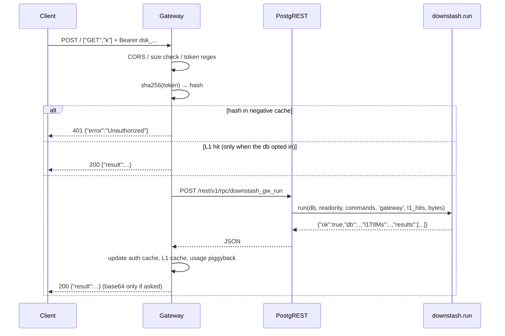

# Data flow

> The three ways a command reaches `downstash.run`, and what happens on the way.

## 1. Gateway (the hot path)



`downstash_gw_run` always receives the SHA-256 hash of the token, never the
token. `results` is always an array; single-mode routes unwrap
`results[0]` ([§9.6](../../plan.md)).

## 2. Direct-RPC failover

`@downstash/client` fails over when the gateway is unavailable: `429`,
`>= 500`, a network error, or a timeout with `failoverOnTimeout` enabled. `400`
and `401` do **not** fail over — re-running a bad request through the other path
would only hide the bug.

| Mode     | RPC                                                          |
| -------- | ------------------------------------------------------------ |
| single   | `POST /rest/v1/rpc/downstash_exec {p_token, p_cmd, p_args}`  |
| pipeline | `POST /rest/v1/rpc/downstash_pipeline {p_token, p_commands}` |
| multi    | `POST /rest/v1/rpc/downstash_multi {p_token, p_commands}`    |

The Downstash token travels in the body and is checked inside the function. A
bad or revoked token returns `{"error":"Unauthorized"}`.

```
POST /rest/v1/rpc/downstash_exec
apikey: <publishable key>
{"p_token":"dsk_…","p_cmd":"PING","p_args":[]}
→ {"result":"PONG"}
```

## 3. Console

Server Actions in `apps/web/features/*/actions.ts` talk to Postgres directly
with the `postgres` driver over the **transaction pooler** — not through
PostgREST, and not through the gateway. They call
`downstash.console_run(db_id, commands)`, which runs with a standard token's
permissions and records usage as `console`.

## Usage accounting

Every path records to `downstash.usage_hourly` with a `p_source`:

| Source     | Who                  | What it counts                                     |
| ---------- | -------------------- | -------------------------------------------------- |
| `gateway`  | the gateway hot path | 1 request + commands, reads, writes, errors, bytes |
| `failover` | the SDK's RPC path   | 1 request + 1 failover_request + the same counters |
| `console`  | the web app          | commands only, no request                          |

The counters are approximate: the gateway batches `l1_hits` and `bytes_out`
per isolate and piggybacks them on the next call. The Usage page says so in a
footnote.

## Related

- [security-model.md](./security-model.md) ·
  [../gateway/request-lifecycle.md](../gateway/request-lifecycle.md) ·
  [../client/failover.md](../client/failover.md)
