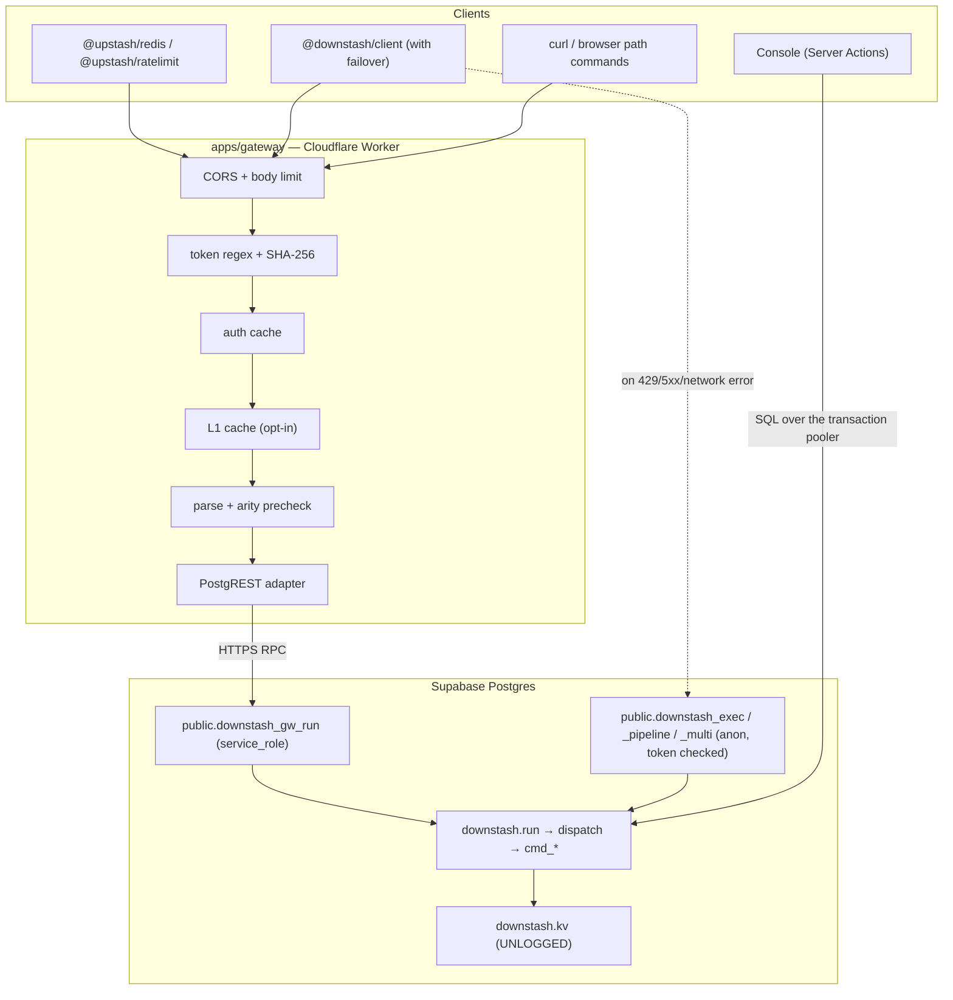

# Architecture overview

> Downstash is a serverless Redis that speaks the Upstash REST protocol, with
> Postgres as the storage engine and a Cloudflare Worker as the gateway. Read
> this before `docs/engine/schema.md` or `docs/gateway/request-lifecycle.md`.

## The one rule that shapes everything

**All command semantics live in PL/pgSQL, inside `downstash.dispatch` and
`downstash.cmd_*`.** The gateway, the SDK's failover RPC and the console's data
browser and CLI all call `downstash.run`. A new command is added in SQL first
([adding-a-command.md](../engine/adding-a-command.md)).

This exists because there are three paths into the same keyspace. If each had
its own implementation, a command would behave differently depending on which
client you used. One implementation means one set of tests.

## Components

| Component         | Lives in                                                            | Job                                                                                                                                           |
| ----------------- | ------------------------------------------------------------------- | --------------------------------------------------------------------------------------------------------------------------------------------- |
| Gateway           | `apps/gateway`                                                      | Upstash REST wire protocol, auth, L1 cache, usage accounting. Holds **no** Redis semantics.                                                   |
| Storage engine    | `supabase/migrations`                                               | The keyspace and every command. Atomic by construction.                                                                                       |
| Protocol package  | `packages/protocol`                                                 | Isomorphic helpers (argv normalisation, base64, tokens, CLI tokenising) shared by the gateway, the web app and the client. Zero dependencies. |
| Client SDK        | `packages/client`                                                   | Gateway-first transport with direct-RPC failover, plus a `Requester` for `@upstash/redis`.                                                    |
| Console + landing | `apps/web`                                                          | Next.js 15. UX copies Upstash; UI is Neo-brutalism.                                                                                           |
| Control plane     | `downstash.databases`, `downstash.tokens`, `downstash.usage_hourly` | Databases, tokens and usage, colocated with the keyspace.                                                                                     |

## Boundaries

- **The gateway never interprets a command.** It validates shape and arity,
  caches, and encodes. Semantics are SQL.
- **`downstash` schema is private.** PostgREST does not expose it, so the anon
  key cannot reach the keyspace directly. Only five vetted functions live in
  `public` (ADR [0002](../adr/0002-private-schema.md)).
- **Tokens are checked inside Postgres.** The Downstash token is the credential;
  the Supabase key only gets you to PostgREST
  (ADR [0003](../adr/0003-token-checked-failover.md)).
- **Every request is one transaction.** pipelined commands run in
  subtransactions, so a mid-pipeline error leaves the earlier ones applied:
  Redis `MULTI` semantics.

## Related

- [data-flow.md](./data-flow.md) · [security-model.md](./security-model.md) ·
  [../engine/schema.md](../engine/schema.md)
